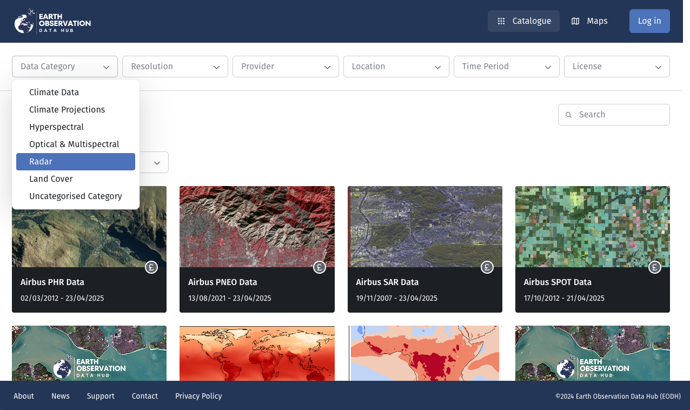
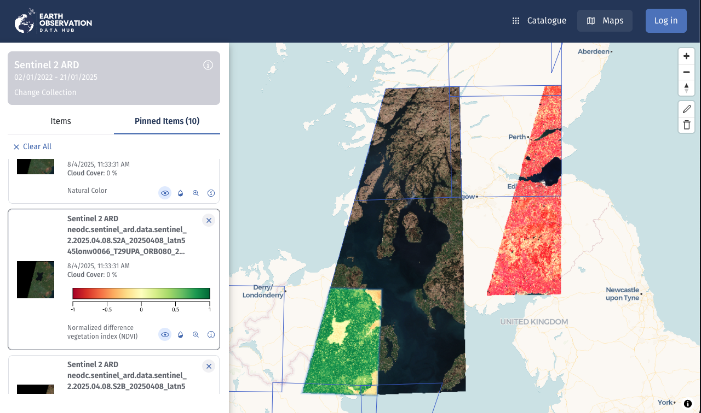
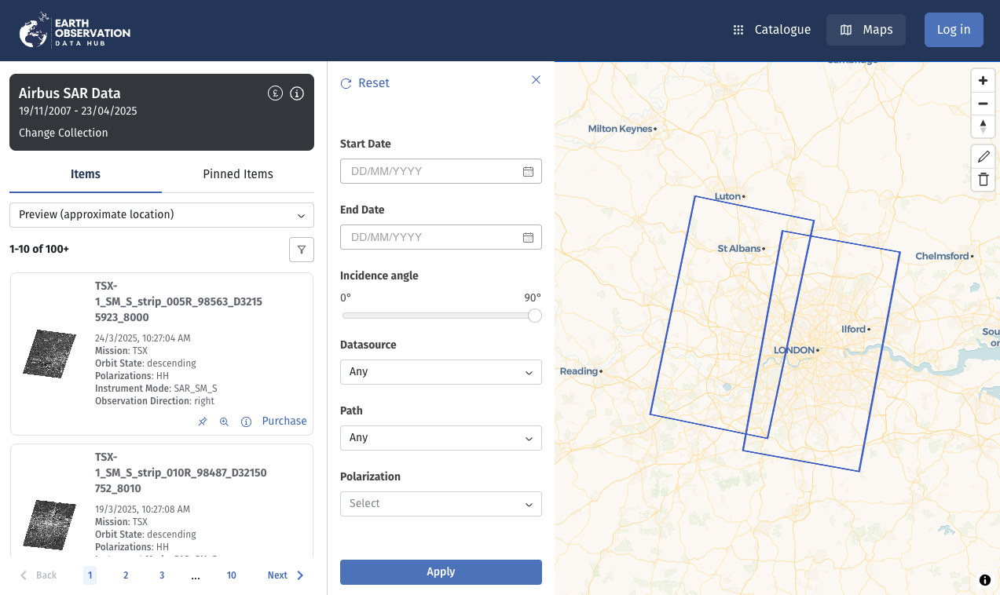

# Configuring STAC Collections for Categorisation, Visualisation, and Filtering

To surface a STAC collection in the application and make it available for visualisation, a the application needs a few hints about that collection.

The sections below list and explain the places you need to edit when adding a new collection or changing its parameters.


## Thematic categorisation on the collection gallery page

Collections can be filtered by category on the collection gallery page. The categories are defined in the `collectionCategorizations` constant and are used to group collections in the gallery.

- [`/src/constants/collectionCategorizations.ts`](../src/constants/collectionCategorizations.ts)

The file contains enums for the categories and a mapping of collection IDs to categories. The categories are used to group collections in the gallery.




## Item visualisation

To visualise items on the map in the item finder page, the application needs to know how to render them. This is done by defining `render` parameters for each collection in the `configFromServer` file.

The render configuration is a JSON object that follows the [STAC Rendering Extension Specification](https://github.com/stac-extensions/render). Most properties are passed on to the [UK EO Data Hub TiTiler Application](https://staging.eodatahub.org.uk/titiler/api.html), which is used to render the items. To understand what the parameters mean, please refer to STAC Rendering Extension Specification but more importantly the TiTiler documentation for the UK EO Data Hub TiTiler service.

- [`/library/configFromServer.json`](../library/configFromServer.json)



There are a few different cases for how data can be rendered on the map. These are described below.


### Multiple renders per collection

A collection can have multiple renders. The `renders` property is a JSON object that maps render names to render configurations.

The renders are listed in the application by their `title`, which is the only required property.

By default, it is assumed that all renders apply to all items in the collections. This is not the case for CMIP6-like collections (CMIP6, UKCP18, CORDEX, etc.), where each item contains a different data variable (e.g. temperature or precipitation). This case is explained further [below](#item-specific-render-parameters).


### Quicklooks

Quicklooks are low-resolution images that are used to preview the data, for example in the case of commercial satellite imagery that has to be purchased before it can be viewed at full resolution. We went at lengths to ensure that quicklooks can be shown on the map, since that offers a proper preview of the image, e.g. before purchasing. Ideally, all catalog providers would include a proper GeoTIFF quicklook or at least a PNG that matches the STAC item bounding box, but that is not the case.

In the STAC catalogs we integrated, we encountered various ways to provide quicklooks. Some catalogs provided proper GeoTIFFs, which can be rendered by TiTiler, others provided only PNGs that do not contain a georeference. 

To still be able to render these images on the map for proper preview, we rely on the georeference information in the STAC item, either the STAC geometry (GeoJSON polygon) or the `bbox` property (bounding box). Which method to use can be defined in the `quicklook_georeference` property of the `renders` object.

| `quicklook_georeference` | Behavior                                                                                     |
|--------------------------|---------------------------------------------------------------------------------------------|
| `bbox`                   | Uses the STAC item's bounding box (bbox property) to georeference the quicklook image.      |
| `geometry`               | Uses the STAC item's geometry (GeoJSON polygon) to georeference the quicklook image. Since the polygon can be arbitrarily complex, we use some heuristics to find the four corner points to anchor the image to. |
| `bbox-squared` | Special case where the PNG image is padded either on the horizontal or vertical side to be square in number of pixels, but the bbox still only corresponds to the (rectangular) image geometry. Here, we post-process the bbox to be squared in UTM coordinates, which works remarkably well considering how crazy it may sound. |


### GeoTIFF or Multidimensional (Zarr, NetCDF, Kerchunk, etc.)?

By default, parameters are passed on to TiTiler for STAC item ID based access. This works best with [Cloud-Optimized GeoTIFFs (COGs)](https://cogeo.org/) but also other [GDAL](https://gdal.org/)-readable formats work.

If the render object contains the `variable` property, it is assumed that the item is a multidimensional dataset (Zarr, NetCDF, Kerchunk, etc.) and the properties are passed on to the [TiTiler endpoint for multidimensional data](https://staging.eodatahub.org.uk/titiler/api.html#/Multi%20Dimensional). 


### Item-specific render parameters

By default, we assume that **renders apply to all items in the collection**. This is not the case for CMIP6-like collections (CMIP6, UKCP18, CORDEX, etc.), where each item contains a different data variable (e.g. temperature or precipitation) and therefore require different rescale ranges, color maps, titles, etc. Another thing that is special about these (climate data) collections is that their items contain many time steps.

We therefore introduced a non-standard property in the collection render configuration to identify such collections, for example:

```json
    "eodhrc:time-variable-items": true,
    "eodhrc:render-key-properties": ["cmip6:variable_id", "cmip6:frequency"],
```

The second property `eodhrc:render-key-properties` defines the **STAC item properties** that should be used to construct the render key by concatenating the property values of the item, separated by a hyphen ()`-`).

For example, for CMIP6, we needed renders to be specific to the `variable_id` (for example `pr` for precipitation) and temporal `frequency` (such as `day` or `mon`), so with the pattern defined above, the render key would be `pr--day` or `pr--mon`:


```json
"renders": {
    "pr--day": {
    "title": "Precipitation (kg m-2 s-1)",
    "assets": ["reference_file"],
    "variable": "pr",
    "colormap_name": "viridis",
    "rescale": [[0.0, 0.0003565374086610976]],
    "reference": true
    },
    "pr--mon": {
    "title": "Precipitation (kg m-2 s-1)",
    "assets": ["reference_file"],
    "variable": "pr",
    "colormap_name": "viridis",
    "rescale": [[3.561188073319953e-8, 0.00015669361280743044]],
    "reference": true
    }
}
```


## Item filtering with CQL2

Items on the item finder can be filtered by CQL2 queries.

Since the properties by which to filter differ between collections, these are defined as JSON Schema forms folder.

By default, all collections can be filtered on `datetime` and `geometry`, so you only need to add collection-specific filters if other properties should be available for filtering.

- [`/src/json-schema-forms/queries/cql2.ts`](`../src/json-schema-forms/queries/cql2.ts`)
- [`/src/json-schema-forms/queries/<collection-id>Query.ts`](../src/json-schema-forms/queries/)
- [`/src/json-schema-forms/assets/<collection-id>.json`](../src/json-schema-forms/assets/)
- [`/src/json-schema-forms/rjsfCollections.ts`](../src/json-schema-forms/rjsfCollections.ts)

